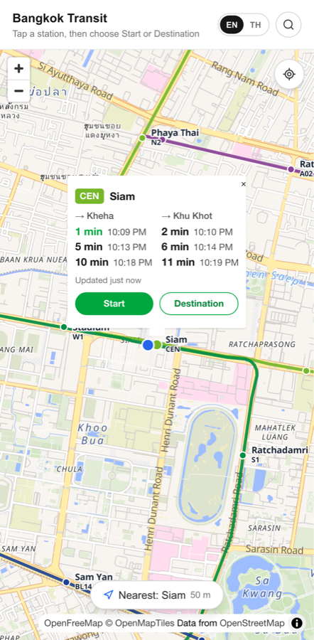
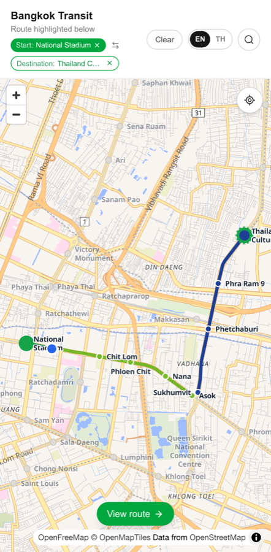
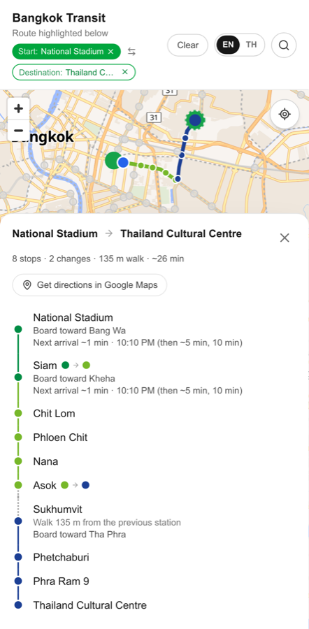

# Bangkok Transit

**[bangkok-transit.com](https://bangkok-transit.com)** — a fast, installable map of every operating rail line in Bangkok (BTS, MRT Blue/Purple/Yellow/Pink, Gold, Airport Rail Link, SRT Red). Tap two stations to get a route with changes, walking transfers, the direction to board and a time estimate; BTS stations show live train arrivals. English and Thai.

<p>
  
  
  
</p>

## Highlights

- **Costs don't grow with users.** Live arrivals are polled once, centrally, by a single Cloudflare Durable Object and published as one JSON file behind the CDN. A thousand riders cost the same as one — everything fits Cloudflare's free tier with wide margins ([cost model](docs/architecture.md#cost-model)).
- **Honest live data.** Countdowns run on the server's clock (corrected from `Date`/`Age` headers), so a phone with a wrong clock still counts down right. If updates stall, the last-known times stay up with their age in amber instead of vanishing; if the source API is down, the app says so.
- **Real routing.** 193 stations, branches and the MRT Blue loop modelled explicitly, curated walking interchanges, Dijkstra over (station, line) states with a minutes-based cost model.
- **Resilient backend.** The poller backs off when the upstream is down, keeps an outage history, skips writes when nothing changed, and is restarted by a cron watchdog if its alarm chain ever stops.
- **Tested end to end.** Unit tests for routing, data invariants and the client's clock/merge logic; the poller is tested inside the real Workers runtime; Playwright drives the production build on desktop and mobile and fails on any console error or CSP violation. A scheduled job checks production every 30 minutes.

## Architecture

```
                         ┌──────────── every 10 s (backs off when upstream is down)
                         ▼
 cron (1/min, watchdog) → ArrivalsPoller (one Durable Object) → bts-api.topmile.com
                                    │                              (no CORS, no batch,
                                    │ arrivals.json                 rate-limited)
                                    ▼
                               R2 bucket ──→ Cloudflare CDN (live.bangkok-transit.com, s-maxage=10)
                                                    │
 bangkok-transit.com (static Next.js export) ──────┤  every browser polls the CDN copy every 15 s
                                                    ▼
                                              phones & laptops
```

The site is a fully static Next.js export served as Cloudflare Workers static assets — no server code. Details, failure modes and the cost model: **[docs/architecture.md](docs/architecture.md)**. Dashboard configuration that isn't in code, and how to diagnose production: **[docs/operations.md](docs/operations.md)**.

## Stack

Next.js 16 (App Router, static export) · React 19 · TypeScript · Tailwind CSS 4 · MapLibre GL with OpenFreeMap vector tiles · Zustand · Serwist (PWA) · Cloudflare Workers, Durable Objects and R2 · Vitest · Playwright · GitHub Actions.

## Develop

Requires Node 22.

```bash
npm install
npm run dev              # http://localhost:3000 (Turbopack, no service worker)
```

| Command | What it does |
| --- | --- |
| `npm run build` | Production build (webpack + Serwist service worker) into `out/` |
| `npm start` | Build, then serve `out/` exactly as production does (`wrangler dev`, with `public/_headers`) |
| `npm run lint` | ESLint, warnings fail |
| `npm run typecheck` | Generates Next's route types, then `tsc` |
| `npm test` | Unit tests (Vitest) |
| `npm run test:e2e` | Playwright against the production build, desktop + mobile |
| `npm run check:live` | Health check of production (site headers, live data, CDN caching) |

The poller lives in [`cloudflare/poller`](cloudflare/poller) with its own `package.json`:

```bash
cd cloudflare/poller
npm install
npm test                 # runs the Durable Object in workerd with a local R2 bucket
npm run smoke            # boots the real Worker with wrangler dev, fires the cron, checks the output
npm run dev              # local poller; trigger the cron at /__scheduled
```

To point the site at a local copy of the live document, set `NEXT_PUBLIC_ARRIVALS_URL` (see `.env.example`).

## CI/CD

- **CI** ([`.github/workflows/ci.yml`](.github/workflows/ci.yml)) on every push and PR: lint, typecheck, unit tests, production dependency audit and the Playwright suite for the site; typecheck, Workers-runtime tests, a dry-run bundle and an audit for the poller.
- **CD** is Cloudflare Workers Builds: a push to `main` builds and deploys the site (repo root) and the poller (`cloudflare/poller`). No Cloudflare credentials are stored in GitHub.
- **Monitoring** ([`.github/workflows/live-check.yml`](.github/workflows/live-check.yml)) runs `scripts/check-live.mjs` against production every 30 minutes; a failure emails the repo owner.

## Data

`data/stations.json` (193 stations), `data/line-sequences.json` (per-line stop order as segments) and `data/interchanges.json` (walking transfers) are hand-maintained and guarded by `tests/data.test.ts`. Track geometry comes from the Bangkok Metropolitan Administration's public GIS service; see [`scripts/README.md`](scripts/README.md).

Live arrivals cover BTS Sukhumvit and Silom (61 stations) — the only lines with a live feed.
